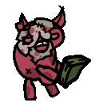
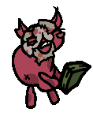
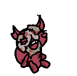
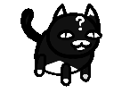

# 演变

没有人问，但这个神秘娱乐项目竟然迭代过四个阶段。

## V1（简单替换）

- 从佬那里了解到 Mewgenics_gpak_util（用来解压gpak文件） 和 FFDec（用来打开和编辑swf文件）。
- 这个阶段搓图前，要在gon文件里读猫各部件的编码，然后到 [Mewgenics Kitty Editor](https://mewgenics.kittyeditor.com/) 网站上生成对应的猫咪图像（直接输 URL ，有些仅供 boss 猫），从图里抠出所有的部件，（被遮挡的部分是用 Photoshop 自己描画的）。
- 这个阶段图最大的两个问题是：
猫的五官在脸正中间；以及猫的手脚没有区分。

最原始版本的“盖恩数钱”

## V2（手搓仙人）

**主要改进**

- 这个时候 [Mewgenics Wiki](https://mewgenics.wiki.gg/) 上有人做出来一部分渲染图，还有 svg 格式。于是就用它优化了部件形状的来源。
- 摸索出了一种通过“替换`PlaceObject2`对象的`characterId`属性”的方式替换猫的部件，因此可以区分手和脚了。

**缺陷**
- 替换标签属性意味着工作量巨大（每处出现的都要换），而且常常会漏掉一两帧的“前腿”没有替换导致“穿帮”。

## V3（万物皆基米）

**主要改进（？）**

- 通过罗列斯佬得到了现在这个项目的前身 Mewgenerate ，此时这个项目生成出来的猫动画没有装备，只识别普通脸和笑脸，最后还要裁剪，但还是能通过它得到的第一帧画面的 svg 文件得到更加清晰的猫部件（只有头部需要手动把装备物品叠放上去）。
- 除了`catanis.swf`和`catanis2.swf`外，也尝试探索了`2d_catanis.swf`（没出战前房子里猫的动画）、`events.swf`（事件猫的动画）、`familiars.swf`（猫开机甲的动画）。
- 用一些部件替换了它原本不会出现的场合（例如拉伸一个猫的图像，用它充当武器等）。
- 甚至是自己画了一些不是`Catgen`的猫、甚至 Mewgenics 里没有的“猫”的资源。

**缺陷**

- 发现一些动画里猫是有表情差分的，苦于难以实现。

在V3实现的盖恩数钱。

在V3实现的盖恩替换德莱文的待机动作，花替换成了戴克。

在V3实现的博弈用脚蹭脸的动画（博弈并不属于`Catgen`，这里手搓了它的5种部件）。

[彩蛋？](./image/V3-zinogre.gif)

## V4（序列装配？）

- 这个阶段基本弃用了 FFDec GUI。
- 在V3时期就开始用程序来搓猫的部件了，一开始觉得用它生成完整动画的逻辑不好用（见前文），后来根据自己习惯改进了大部分和生成动画有关的代码片段，一开始主要是自己动手改，后来用 Copilot 的 free plan，最后也是终于体验并接入了 DSH 。
- 目前的动画生成更加精致且准确了，在 DSH 的帮助下最后一步去 ezgif 裁剪的过程也省了。

另见仓库的[更新日志](../changes.md)。